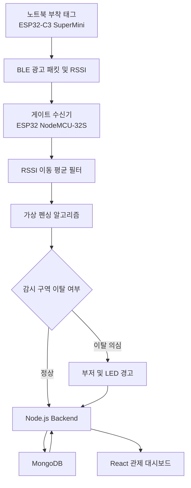
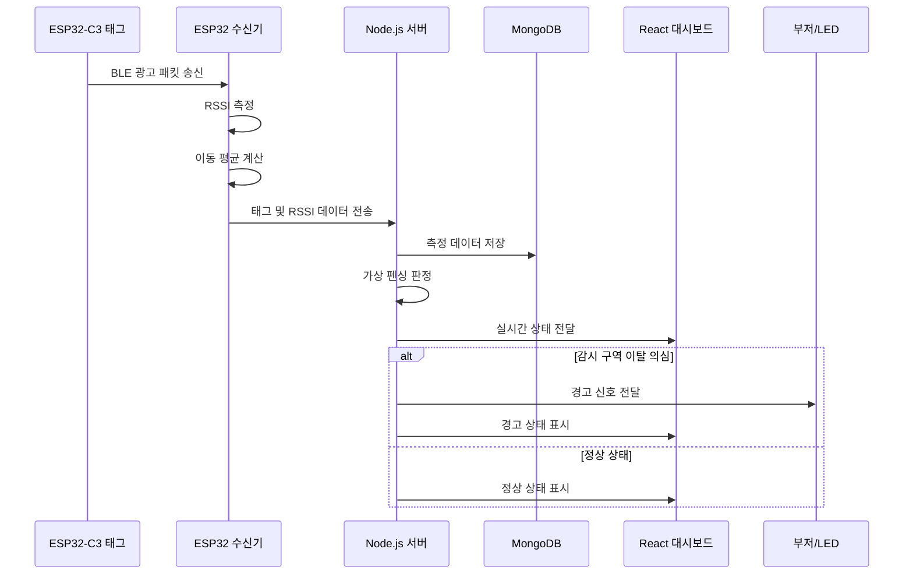

# ESP32 기반 카페 도난 방지 시스템

> ESP32와 BLE RSSI 신호를 활용한 카페·공공장소용 노트북 도난 의심 상황 감지 및 실시간 관제 시스템

## 📌 프로젝트 소개

본 프로젝트는 카페, 도서관, 스터디카페 등 공공장소에서 사용자가 자리를 비운 사이 발생할 수 있는 노트북 도난 사고를 예방하기 위해 개발하는 **ESP32 기반 도난 방지 시스템**입니다.

노트북에 부착된 ESP32-C3 SuperMini 태그와 감시 구역에 설치된 ESP32 NodeMCU-32S 수신기 사이의 BLE 신호를 측정하고, RSSI 값을 분석하여 태그의 상대적인 거리 변화와 감시 구역 이탈 여부를 추정합니다.

설정된 감시 기준을 벗어난 상황이 일정 시간 지속되면 도난 의심 상태로 판단하고, 부저와 LED를 통해 경고하며 React 기반 웹 관제 대시보드에 실시간 상태를 표시합니다.

> 본 시스템은 RSSI 특성상 주변 환경의 영향을 받을 수 있으므로 도난 여부를 확정하는 시스템이 아닌, 도난 의심 상황을 감지하고 관리자에게 알림을 제공하는 시스템입니다.

---

## 🎯 개발 목표

- ESP32 기반 BLE 태그 및 수신기 구현
- 노트북과 태그의 신호 상태 및 거리 변화 감지
- RSSI 이동 평균 필터를 이용한 신호 노이즈 감소
- 가상 펜싱(Virtual Fencing) 기반 감시 구역 이탈 감지
- 도난 의심 상황 발생 시 부저 및 LED 알림
- Node.js와 MongoDB를 이용한 데이터 저장 및 관리
- React 기반 실시간 관제 대시보드 구현
- 태그 등록 및 대여·반납 상태 관리
- 하드웨어와 웹 서비스를 연동한 통합 시스템 구축

---

## 💡 개발 배경 및 필요성

카페나 도서관과 같은 공공장소에서는 사용자가 노트북을 책상 위에 둔 채 자리를 비우는 경우가 많습니다. 이때 노트북이 이동하거나 도난당하더라도 즉시 인지하기 어려운 문제가 발생할 수 있습니다.

본 프로젝트는 다음과 같은 방식으로 문제를 해결하고자 합니다.

1. 노트북에 소형 ESP32-C3 SuperMini 태그 부착
2. 감시 구역에 ESP32 NodeMCU-32S 수신기 설치
3. BLE 광고 패킷과 RSSI 값 수집
4. RSSI 이동 평균을 이용한 노이즈 완화
5. 설정된 기준을 벗어나면 도난 의심 상태로 판단
6. 부저, LED, 웹 대시보드를 통한 실시간 알림

---

## 🧩 주요 기능

### 1. 태그 등록 및 관리

- 태그 고유 식별자 관리
- 태그 이름 및 장비 정보 등록
- 태그 대여 및 반납 상태 관리
- 등록된 태그의 현재 상태 확인
- 태그별 감시 상태 확인

### 2. BLE 신호 수집

ESP32 NodeMCU-32S 수신기는 ESP32-C3 SuperMini 태그의 BLE 광고 패킷을 검색합니다.

수집 정보:

- 태그 식별자
- BLE 신호 수신 여부
- RSSI 값
- 마지막 수신 시간
- 태그 상태

### 3. RSSI 이동 평균 필터

RSSI는 주변 환경에 따라 순간적으로 크게 변할 수 있으므로 최근 측정값을 저장하여 이동 평균을 계산합니다.

```text
최근 RSSI 값: -55, -58, -62, -60, -57

이동 평균:
(-55 + -58 + -62 + -60 + -57) / 5
= -58.4
```

이동 평균 필터를 적용하여 순간적인 RSSI 튐 현상과 잘못된 경고 발생을 줄입니다.

### 4. 가상 펜싱(Virtual Fencing)

태그가 설정된 감시 범위를 벗어났는지 판단합니다.

판정 기준 예시:

- RSSI 평균값이 설정 기준보다 낮아지는 경우
- 일정 시간 동안 태그 신호가 수신되지 않는 경우
- RSSI 감소 상태가 지속되는 경우
- 등록되지 않은 태그가 감지되는 경우

### 5. 도난 의심 알림

도난 의심 상황 발생 시 다음과 같이 알림을 제공합니다.

#### 하드웨어 알림

- Active Buzzer 경고음
- Red LED 경고 표시
- 수신기 상태에 따른 알림 제어

#### 웹 알림

- 도난 의심 태그 표시
- 태그 상태 변경
- 마지막 신호 수신 시간 표시
- RSSI 값 표시
- 관리자 화면에 경고 메시지 출력

### 6. 실시간 관제 대시보드

React 기반 웹 화면에서 등록된 태그의 상태를 실시간으로 확인합니다.

- 전체 태그 목록
- 정상·주의·경고 상태
- RSSI 값
- 마지막 수신 시간
- 태그 대여 및 반납 상태
- 도난 의심 태그 강조 표시
- 실시간 상태 갱신

### 7. 태그 대여 관리

- 태그 대여 등록
- 사용자 또는 장비 정보 관리
- 대여 시간 기록
- 반납 상태 관리
- 대여 중인 태그 조회
- 태그별 사용 상태 확인

---

## 🏗️ 시스템 구성



### 시스템 구성 요소

| 구성 요소 | 역할 |
|---|---|
| ESP32-C3 SuperMini | 노트북 부착 태그, BLE 광고 패킷 송신 |
| ESP32 NodeMCU-32S | BLE 태그 검색, RSSI 수집, 알림 제어 |
| Node.js | 서버 구성, 데이터 처리, API 및 실시간 통신 |
| MongoDB | 태그·대여·RSSI·경고 이력 저장 |
| React | 실시간 관제 대시보드 및 관리 화면 |
| Buzzer | 도난 의심 상황 경고음 발생 |
| Red LED | 경고 상태 시각적 표시 |

---

## 🛠️ 기술 스택

| 구분 | 기술 | 사용 목적 |
|---|---|---|
| 하드웨어 | ESP32 NodeMCU-32S | BLE 수신기 및 알림 장치 |
| 하드웨어 | ESP32-C3 SuperMini | 노트북 부착 태그 |
| 통신 | BLE | 태그 광고 패킷 및 RSSI 수집 |
| 알고리즘 | RSSI 이동 평균 필터 | RSSI 노이즈 감소 |
| 알고리즘 | 가상 펜싱 | 감시 구역 이탈 판정 |
| 백엔드 | Node.js | 서버 및 데이터 처리 |
| 데이터베이스 | MongoDB | 태그·대여·측정 데이터 저장 |
| 프론트엔드 | React | 관제 대시보드 및 관리 화면 |
| 실시간 통신 | WebSocket 또는 Socket 기반 통신 | 실시간 상태 전달 |
| 형상 관리 | Git / GitHub | 소스 코드 및 문서 관리 |

---

## 🔌 하드웨어 구성

| 부품명 | 수량 | 용도 |
|---|---:|---|
| ESP32 NodeMCU-32S | 1개 | BLE 게이트 수신기 |
| ESP32-C3 SuperMini | 2개 | 노트북 부착 태그 |
| LiPo 배터리 | 2개 | 태그 전원 공급 |
| TP4056 충전 모듈 | 2개 | 배터리 충전 |
| Active Buzzer | 1개 | 도난 의심 경고음 |
| 저항 키트 | 1개 | LED 및 회로 구성 |
| 브레드보드 세트 | 1개 | 회로 테스트 |
| Red LED | 1세트 | 경고 상태 표시 |
| 점퍼선 M/F | 1개 | 회로 연결 |
| 점퍼선 M/M | 1개 | 회로 연결 |
| 점퍼선 F/F | 1개 | 회로 연결 |
| USB-A to Type-C 케이블 | 2개 | 전원 및 개발 연결 |

### 하드웨어 동작 예시

```text
[ESP32-C3 SuperMini]
        │
        │ BLE 광고 패킷 송신
        ▼
[ESP32 NodeMCU-32S]
        │
        ├── RSSI 측정
        ├── 이동 평균 계산
        ├── 감시 구역 이탈 판단
        ├── Buzzer 제어
        └── Red LED 제어
```

### 게이트보드 배선 (ESP32 NodeMCU-32S)

| GPIO | 연결 | 비고 |
|---|---|---|
| GPIO25 | Active Buzzer (+) | Buzzer (-) → GND |
| GPIO26 | Red LED (+, 220Ω 직렬) | 경고 표시 |
| GPIO27 | Green LED (+, 220Ω 직렬) | 서버 연결 상태 (켜짐: 정상 / 깜빡임: 오프라인) — 선택 |

지급보드(ESP32-C3 SuperMini)는 별도 배선 없이 내장 LED(GPIO8)로 동작 여부만 표시합니다.

---

## 🔄 시스템 동작 흐름



---

## 📊 태그 상태 기준

| 상태 | 설명 | 시스템 동작 |
|---|---|---|
| 정상 | 태그 신호가 안정적으로 수신됨 | 정상 상태 표시 |
| 주의 | RSSI 값이 기준보다 약해짐 | 상태 모니터링 |
| 경고 | RSSI 감소 또는 신호 미수신이 지속됨 | 부저 및 LED 작동 |
| 미등록 | 등록되지 않은 태그 감지 | 관리자 확인 요청 |
| 미수신 | 일정 시간 동안 태그 신호 없음 | 도난 의심 가능성 표시 |

> RSSI 기준값과 판정 시간은 실제 현장 테스트를 통해 조정합니다.

---

## 👥 팀 구성 및 역할

### 지도교수

| 구분 | 이름 | 역할 |
|---|---|---|
| 지도교수 | 이명문 | 프로젝트 지도 및 전체 개발 방향 검토 |

### 산업체 멘토

| 구분 | 소속 및 이름 | 역할 |
|---|---|---|
| 산업체 멘토 | 인천일보아카데미 조윤현 교육팀장 | 개발 방향 자문 및 프로젝트 멘토링 |

### 학생 팀원

| 구분 | 이름 | 역할 |
|---|---|---|
| 팀장 | 이주현 | 하드웨어 구성, 백엔드 개발, 전체 일정 관리 |
| 팀원 | 장진혁 | 하드웨어 구성, 프론트엔드 개발, UI 구현 |

---

## 📅 개발 일정

### 1단계: 요구사항 분석 및 시스템 설계

- 프로젝트 목표 및 범위 설정
- 도난 방지 시스템 요구사항 분석
- 전체 시스템 구조 설계
- 하드웨어와 소프트웨어 역할 분리
- 태그 및 수신기 동작 방식 정의

### 2단계: 기능 명세 및 DB/UI 설계

- 태그 등록 기능 정의
- 태그 대여 및 반납 기능 정의
- MongoDB 데이터 구조 설계
- React 화면 구성 설계
- API 목록 작성
- 태그 상태 및 경고 상태 정의

### 3단계: 하드웨어 점검 및 프로토타입 제작

- ESP32 NodeMCU 동작 확인
- ESP32-C3 SuperMini 동작 확인
- BLE 송수신 테스트
- 부저 및 LED 테스트
- 배터리 및 충전 모듈 점검
- 브레드보드 기반 회로 구성

### 4단계: ESP32 및 센서 기능 통합

- BLE 태그 광고 기능 구현
- ESP32 수신기 스캔 기능 구현
- RSSI 수집 기능 구현
- 태그 식별자 확인
- 부저 및 LED 제어 기능 구현

### 5단계: Node.js 백엔드 개발

- Node.js 서버 구성
- ESP32 데이터 수신 API 구현
- RSSI 이동 평균 필터 구현
- 가상 펜싱 알고리즘 구현
- 태그 상태 변경 로직 구현
- 경고 발생 조건 구현

### 6단계: MongoDB 및 API 연동

- 태그 정보 저장
- 대여 및 반납 정보 저장
- RSSI 데이터 저장
- 경고 이력 저장
- 태그 조회 API 구현
- 태그 상태 변경 API 구현

### 7단계: React 관제 대시보드 개발

- 태그 목록 화면 구현
- 태그 상태 화면 구현
- 대여 관리 화면 구현
- RSSI 및 마지막 수신 시간 표시
- 경고 상태 표시
- 실시간 소켓 통신 연동

### 8단계: 통합 테스트 및 결과물 정리

- 하드웨어와 서버 연동 테스트
- 서버와 React 화면 연동 테스트
- RSSI 기준값 테스트
- 가상 펜싱 동작 테스트
- 부저 및 LED 경고 테스트
- 태그 대여 및 반납 테스트
- 최종 보고서 및 발표 자료 작성

---

## 🗂️ 프로젝트 폴더 구조

```text
CafeGuard/
├── README.md
├── firmware/
│   ├── gate/                 # 게이트보드 (ESP32 NodeMCU-32S)
│   │   ├── gate.ino
│   │   └── secrets.example.h # → secrets.h 로 복사 후 Wi-Fi/서버 정보 입력
│   └── tag/                  # 지급보드 (ESP32-C3 SuperMini)
│       └── tag.ino
├── backend/
│   ├── index.js              # 서버 시작 (MongoDB 연결, Socket.IO)
│   ├── src/
│   │   ├── app.js            # REST API
│   │   ├── config.js
│   │   ├── models/           # Tag, Gate, Alarm, Event, RssiLog, Settings
│   │   └── services/
│   │       ├── detector.js   # 이동 평균 + 게이트 통과 판정 (순수 로직)
│   │       └── monitor.js    # 실시간 상태 관리, 알람 발생
│   ├── scripts/simulate-gate.js  # 하드웨어 없이 테스트하는 게이트 시뮬레이터
│   ├── test/                 # node:test 단위 테스트
│   └── .env.example
└── frontend/
    ├── vite.config.js        # 개발 시 /api, /socket.io → 백엔드 프록시
    └── src/
        ├── App.jsx
        ├── components.jsx    # 알람 배너, 게이트, 지급보드, 등록, 설정, 이력
        ├── hooks.js          # Socket.IO 구독, 경고음
        └── api.js
```

---

## ▶️ 실행 및 테스트 가이드

### 1. MongoDB 준비 (둘 중 하나)

- **로컬 설치**: [MongoDB Community Server](https://www.mongodb.com/try/download/community) 설치 후 기본 포트(27017)로 실행
- **MongoDB Atlas (무료 M0)**: 클러스터 생성 → Database Access에서 사용자 생성 → Network Access에 PC의 IP 추가 → 연결 문자열 복사

### 2. 백엔드 실행

```bash
cd backend
cp .env.example .env      # MONGODB_URI, DEVICE_KEY 수정
npm install
npm run dev               # http://localhost:5000
npm test                  # 판정 로직 단위 테스트
```

> 게이트보드가 접속해야 하므로 서버는 `0.0.0.0`으로 열립니다. Windows 방화벽에서 Node.js의 개인 네트워크 접근을 허용하세요.

### 3. 대시보드 실행

```bash
cd frontend
npm install
npm run dev               # http://localhost:5173 (API는 자동으로 5000번 포트로 프록시)
```

배포 시에는 `npm run build` 후 백엔드만 실행하면 `http://<서버IP>:5000`에서 대시보드까지 함께 제공됩니다.

### 4. 하드웨어 없이 먼저 테스트 (시뮬레이터)

```bash
cd backend
npm run simulate -- --key <DEVICE_KEY> --tags 2
```

1. 대시보드에 `GATE-01` 게이트가 나타나고, 미등록 감지 목록에 `CG-TAG-01`, `CG-TAG-02`가 표시됨
2. 클릭해서 지급보드로 등록
3. 시뮬레이터 터미널에서 `1` 또는 `2` 입력 → 해당 지급보드가 게이트를 통과 → 대시보드 경보 + 시뮬레이터에 `🔔 BUZZER ON` 표시
4. 대시보드에서 **알람 해제** → 부저 꺼짐

### 5. 펌웨어 업로드 (Arduino IDE)

1. 보드 매니저: **esp32 by Espressif Systems 3.x** 설치
2. 라이브러리 매니저: **NimBLE-Arduino 2.x**, **ArduinoJson 7.x** 설치
3. 지급보드: `firmware/tag/tag.ino`의 `TAG_ID`를 태그마다 다르게(`CG-TAG-01`, `CG-TAG-02`) 설정 → 보드 `ESP32C3 Dev Module`, USB CDC On Boot `Enabled`로 업로드
4. 게이트보드: `firmware/gate/secrets.example.h` → `secrets.h`로 복사해 Wi-Fi, 서버 주소(PC의 내부 IP), `DEVICE_KEY` 입력 → 보드 `ESP32 Dev Module`, Partition Scheme `Huge APP (3MB No OTA)`로 업로드
5. 시리얼 모니터(115200)에서 `[WiFi] 연결됨`, 태그별 RSSI 출력 확인

> ESP32는 2.4GHz Wi-Fi만 지원합니다. PC와 게이트보드가 같은 네트워크에 있어야 합니다.

### 6. 현장 튜닝 (중요)

RSSI는 설치 환경(벽, 사람, 금속)에 따라 크게 달라지므로 기본 임계값(-55 dBm)을 그대로 쓰기보다 실측으로 맞춰야 합니다.

1. 지급보드를 평소 자리(좌석)에 두고 대시보드의 이동평균 값을 확인 (예: -78 dBm)
2. 지급보드를 들고 문(게이트 바로 옆)을 지나가며 최대값 확인 (예: -45 dBm)
3. **판정 설정**에서 임계값을 두 값의 중간보다 게이트 쪽(예: -55 dBm)으로 설정
4. 좌석에서 오탐이 나면 임계값을 올리고(-50), 통과를 놓치면 내리거나 근접 유지 시간을 줄임

게이트보드는 문틀 높이 1m 전후, 좌석 쪽보다 출입 동선 쪽을 향하도록 설치하면 좌석과의 신호 차이가 커져 판정이 안정적입니다.

### 게이트 통과 판정 방식

```text
게이트보드: 1초 동안 받은 광고 패킷 RSSI 평균 → 서버 보고
서버:      최근 N개(기본 5) 이동 평균 ≥ 임계값 상태가 1.5초 이상 지속 → "통과"
           감시 ON 지급보드면 알람 생성 → 게이트 응답 alarm=true → 부저/LED
           알람은 대시보드에서 해제할 때까지 유지
           통과 후 (임계값 - 여유) 아래로 멀어져야 재판정 (게이트 앞 체류 시 중복 알람 방지)
서버 장애: 게이트가 마지막 설정으로 자체 판정해 부저를 울리고, 복구되면 기록을 서버에 보고
```

### 주요 API

| Method | Path | 설명 |
|---|---|---|
| POST | `/api/device/report` | 게이트보드 보고 (헤더 `X-Device-Key`) |
| GET | `/api/state` | 전체 실시간 상태 |
| POST / PATCH / DELETE | `/api/tags`, `/api/tags/:tagId` | 지급보드 등록/수정(감시 ON·OFF, 지급 대상)/삭제 |
| POST | `/api/gates/:gateId/test-alarm` | 게이트 부저 테스트 (3초) |
| POST | `/api/alarms/:id/ack`, `/api/alarms/ack-all` | 알람 해제 |
| GET / PUT | `/api/settings` | 판정 설정 |
| GET | `/api/events?limit=100&tagId=` | 이력 조회 |

실시간 갱신은 Socket.IO `state`(전체 스냅샷), `alarm`(신규 알람) 이벤트로 전달됩니다.

---

## 🧪 테스트 계획

### 하드웨어 테스트

- ESP32-C3 SuperMini BLE 광고 여부 확인
- ESP32 NodeMCU BLE 스캔 여부 확인
- RSSI 값 정상 수집 여부 확인
- 부저 작동 여부 확인
- Red LED 작동 여부 확인
- 배터리 및 충전 모듈 동작 확인

### 알고리즘 테스트

- RSSI 이동 평균 계산 확인
- RSSI 순간 튐 현상 확인
- 감시 구역 이탈 기준 확인
- 신호 미수신 시간 기준 확인
- 정상 상태와 경고 상태 전환 확인

### 서버 테스트

- 태그 데이터 수신 테스트
- MongoDB 저장 테스트
- 태그 등록 및 조회 테스트
- 대여 및 반납 기능 테스트
- 경고 이력 저장 테스트
- 실시간 데이터 전달 테스트

### 프론트엔드 테스트

- 태그 목록 표시 확인
- 태그 상태 변경 확인
- 경고 태그 표시 확인
- 대여 및 반납 화면 확인
- 실시간 데이터 갱신 확인
- 비정상 데이터 처리 확인

---

## 💰 예상 개발 비용

| 품목 | 수량 | 금액 |
|---|---:|---:|
| ESP32 NodeMCU-32S | 1개 | 10,600원 |
| ESP32-C3 SuperMini | 2개 | 19,800원 |
| LiPo 배터리 | 2개 | 17,200원 |
| TP4056 충전 모듈 | 2개 | 2,600원 |
| Active Buzzer | 1개 | 1,400원 |
| 저항 키트 | 1개 | 1,600원 |
| 브레드보드 세트 | 1개 | 19,800원 |
| Red LED | 1세트 | 1,000원 |
| 점퍼선 M/F | 1개 | 1,200원 |
| 점퍼선 M/M | 1개 | 1,200원 |
| 점퍼선 F/F | 1개 | 1,200원 |
| USB-A to Type-C 케이블 | 2개 | 3,800원 |
| **총액** |  | **81,400원** |

---

## 📈 기대효과

### 1. 도난 사고 예방

노트북이나 개인 장비의 이동을 감지하여 도난 의심 상황을 빠르게 인지할 수 있습니다.

### 2. 실시간 상태 확인

관리자는 React 기반 관제 대시보드를 통해 등록된 태그의 상태를 실시간으로 확인할 수 있습니다.

### 3. 저비용 시스템 구축

ESP32와 오픈소스 기반 기술을 활용하여 비교적 저렴한 비용으로 도난 방지 시스템을 구현할 수 있습니다.

### 4. 하드웨어와 웹 기술의 융합

- 임베디드 하드웨어 제어
- BLE 통신
- RSSI 데이터 처리
- 서버 개발
- 데이터베이스 설계
- 실시간 웹 통신
- React UI 개발

### 5. 확장 가능성

- 여러 개의 수신기 설치
- 좌석별 태그 위치 관리
- 모바일 알림 기능
- 관리자 로그인 기능
- 태그별 사용 통계
- 도난 발생 이력 조회
- CCTV 및 출입 관리 시스템 연동

---

## ⚠️ 한계 및 고려사항

BLE RSSI는 다음과 같은 환경적 요인의 영향을 받을 수 있습니다.

- 사람의 움직임
- 벽이나 책상 등의 장애물
- 주변 전자기기
- 태그의 방향
- 수신기와 태그의 위치
- 배터리 상태
- 주변 BLE 기기 수

따라서 본 프로젝트는 RSSI만으로 도난 여부를 확정하는 시스템이 아니라, RSSI 변화와 신호 미수신 상태를 활용하여 도난 의심 상황을 감지하고 관리자에게 알림을 제공하는 시스템입니다.

실제 적용 시에는 다음 사항을 검증해야 합니다.

- 현장 환경에 맞는 RSSI 기준값 설정
- 일정 시간 이상 상태가 지속될 때만 경고 발생
- 오탐 방지를 위한 이동 평균 및 추가 필터 적용
- 태그와 수신기 설치 위치 최적화
- 배터리 사용 시간 검증
- 충전 회로 및 배터리 안전성 검토

---

## 🚀 향후 발전 방향

1. 복수 수신기를 활용한 위치 추정
2. BLE RSSI와 다른 센서 데이터 결합
3. 관리자 모바일 알림 기능 추가
4. 태그별 거리 변화 그래프 제공
5. 사용자별 대여 이력 관리
6. 관리자 권한 및 로그인 기능 추가
7. 클라우드 서버 배포
8. 여러 매장에 적용할 수 있는 다중 지점 관리
9. 머신러닝 기반 RSSI 이상 상태 분석
10. 실제 카페 환경에서의 장기간 테스트

---

## 📌 프로젝트 결과물

- ESP32-C3 SuperMini 기반 BLE 태그
- ESP32 NodeMCU-32S 기반 BLE 수신기
- 부저 및 LED 경고 장치
- Node.js 백엔드 서버
- MongoDB 데이터베이스
- React 실시간 관제 대시보드
- 태그 등록 및 대여 관리 기능
- 시스템 구성도 및 회로 설계 문서
- 테스트 결과 보고서
- 최종 발표 자료

---

## 👨‍💻 팀 정보

| 구분 | 내용 |
|---|---|
| 팀명 | 컴정화이팅 |
| 학과 | 컴퓨터정보과 |
| 교과목 | 캡스톤디자인 |
| 지도교수 | 이명문 |
| 산업체 멘토 | 인천일보아카데미 조윤현 교육팀장 |
| 팀장 | 이주현 |
| 팀원 | 장진혁 |

---

## 📄 라이선스

본 프로젝트는 캡스톤디자인 과제 및 학습 목적으로 제작되었습니다.
